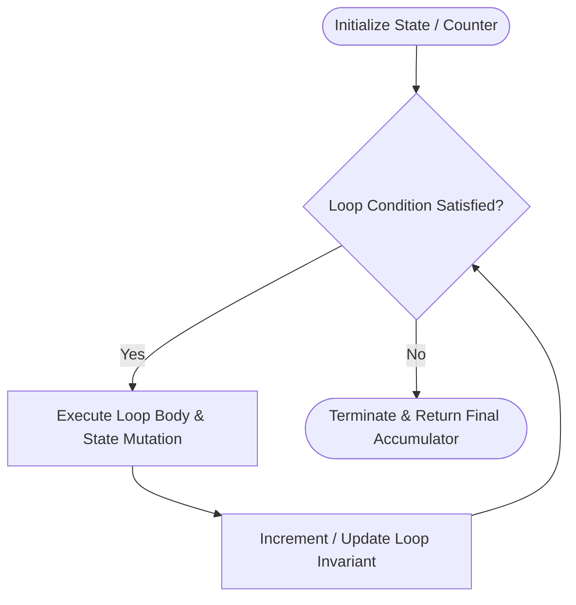

<p align="center">
  
</p>

<p align="center">
  
  
  
  
  
</p>

---

## Executive Summary / Overview
### Problem Statement & Context
Iteration is the bedrock of computational algorithms. Understanding how iteration constructs manage state, step-by-step state mutability, and termination conditions is critical for building performant software. In procedural and algorithmic programming, inefficient loop design frequently leads to unnecessary overhead, infinite loops, or off-by-one boundary failures.

### Solution Overview
This repository presents an empirical exploration of Python's iterative control structures. It isolates loop invariants, accumulator logic, conditional break/continue pathways, and state transitions within cleanly structured, verifiable Jupyter Notebook environments. The implementations provide direct insight into how deterministic repetition behaves at the interpreter level.

---

## Interactive Table of Contents
- [Executive Summary / Overview](#executive-summary--overview)
- [Key Features & Capabilities](#key-features--capabilities)
- [System Architecture / Pipeline](#system-architecture--pipeline)
- [Tech Stack Breakdown](#tech-stack-breakdown)
- [Reproducible Quickstart & Setup](#reproducible-quickstart--setup)
- [Project Directory Layout](#project-directory-layout)
- [Author & Contributions](#author--contributions)

---

## Key Features & Capabilities
- **Deterministic State Tracking:** Implements clear accumulator variables and boundary assertions to guarantee deterministic loop termination.
- **Controlled Flow Management:** Demonstrates idiomatic usage of `while` loops, condition updates, and edge-case boundary checks.
- **Asymptotic Complexity Verification:** Demonstrates O(n) linear runtime loops and analyzes state transitions per iteration cycle.
- **Zero-Dependency Reproducibility:** Clean pure-Python constructs requiring no heavy third-party framework overhead.

---

## System Architecture / Pipeline


---

## Tech Stack Breakdown
| Layer | Technology | Purpose |
| :--- | :--- | :--- |
| **Languages** | Python 3.10+ | Core algorithmic execution runtime |
| **Libraries** | Python Standard Library | Arithmetic operations and stream assertions |
| **Tools** | Jupyter Notebook | Stepwise evaluation and trace visualization |
| **Architecture** | Procedural / Structured | State-based iteration and accumulator mechanics |

---

## Reproducible Quickstart & Setup
```bash
# 1. Clone repository
git clone https://github.com/suryateja-155/000.git
cd 000

# 2. Virtual environment setup
python -m venv venv
# Windows:
.\venv\Scripts\activate
# Linux/macOS:
source venv/bin/activate

# 3. Install Jupyter runtime
pip install jupyterlab notebook

# 4. Launch the notebook
jupyter lab looping.ipynb
```

---

## Project Directory Layout
```text
000/
├── looping.ipynb       # Stepwise iteration logic and loop evaluations
└── README.md           # Project architecture and technical specification
```

---

## Author & Contributions

**Gettupalli Surya Teja**  
- GitHub Profile: [@suryateja-155](https://github.com/suryateja-155)  
- Portfolio Index: [Gettupalli-Surya-Teja](https://github.com/suryateja-155/Gettupalli-Surya-Teja)

Contributions, issue reports, and feedback are always welcome! Feel free to open an issue or pull request.

<p align="center">
  
</p>
